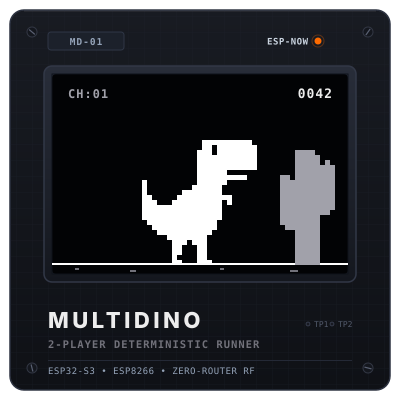
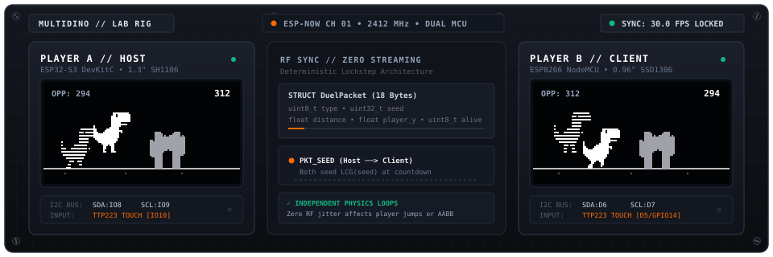
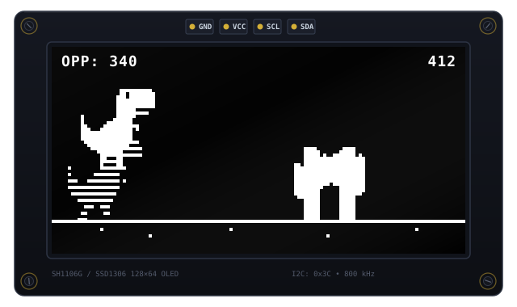
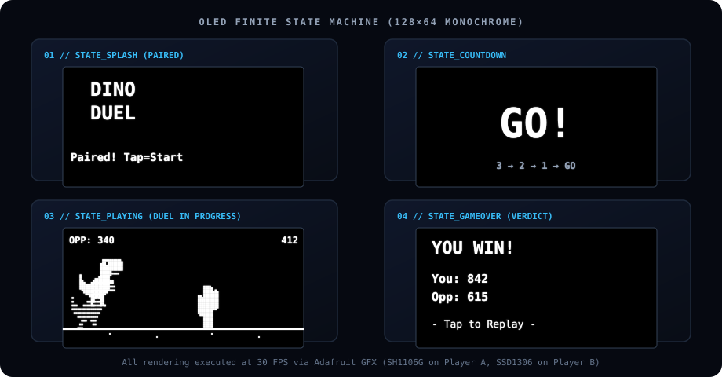
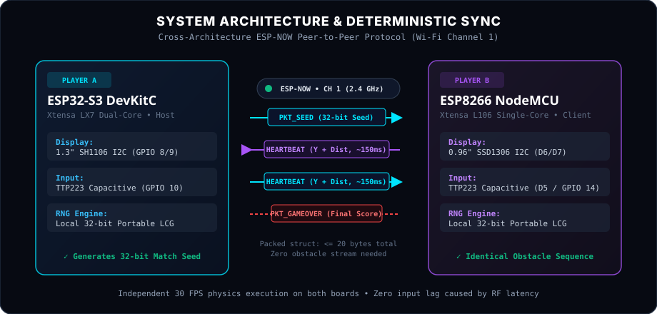

<p align="center">
  
</p>

<h1 align="center">MultiDino</h1>

<p align="center">
  <strong>Cross-architecture, two-player Chrome Dino runner over ESP-NOW with deterministic seed synchronization and real-time ghost sprites.</strong>
</p>

<p align="center">
  
  
  
  
  
</p>

<p align="center">
  
</p>

---

## Overview

**MultiDino** is a wireless, two-player physical implementation of the classic Chromium T-Rex runner built for microcontrollers. Two players on entirely different silicon architectures—an **ESP32-S3** (Player A / Host) and an **ESP8266** (Player B / Client)—race simultaneously through the exact same randomized obstacle field on monochrome OLED displays.

The boards communicate peer-to-peer using **ESP-NOW** at 2.4 GHz without needing a Wi-Fi router, local access point, or cloud server.

Rather than streaming obstacle coordinates across the radio (which consumes bandwidth and introduces frame jitter), MultiDino uses **deterministic lockstep seed generation**:
1. At the start of a match, the host generates a single 32-bit random seed and broadcasts it to the client.
2. Both microcontrollers feed this seed into an identical, compiler-independent **Linear Congruential Generator (LCG)**.
3. Both boards produce the exact same sequence of cactus obstacles, spacing intervals, and speed curves locally.
4. Each device runs its own jump physics, gravity, and collision detection at a solid 30 FPS.
5. Lightweight periodic heartbeats (~150 ms) exchange distance and vertical position, rendering your opponent as a **semi-transparent ghost dinosaur** running beside you in real time.

---

## Visual Previews

### Live Match Duel (128×64 Monochrome OLED)

The OLED screen renders your dinosaur, approaching single and double cactuses, a scrolling ground plane, a running score, and the opponent's relative distance indicator. When paired, your opponent's avatar appears as a scanline-masked ghost dinosaur running and jumping alongside you.

<p align="center">
  
</p>

### Finite State Machine & Screen Flow

The game cycles through four synchronized states handled by an explicit state machine on both boards:

<p align="center">
  
</p>

1. **`STATE_SPLASH` (Pairing & Solo Mode):** The boards broadcast `HELLO` packets every 500–600 ms. If tapped while searching, the board drops immediately into offline **Solo Mode**. Once the peer responds, the screen updates to `"Paired! Tap=Start"`.
2. **`STATE_COUNTDOWN` (Synchronized Start):** Displays a 3 &rarr; 2 &rarr; 1 &rarr; GO! countdown (800 ms per step + 400 ms GO hold) so both players jump into physics frame 0 simultaneously.
3. **`STATE_PLAYING` (Active Duel):** Fixed-timestep 30 FPS physics loop. Jumps and AABB collisions are evaluated locally. Periodic 20-byte heartbeats update the opponent ghost position and top-left HUD (`OPP: <dist>` or `OPP:OUT`).
4. **`STATE_GAMEOVER` & `STATE_GAMEOVER_WAIT` (Verdict):** If you crash first, your board enters `STATE_GAMEOVER_WAIT` and continues broadcasting your final score until the opponent also finishes. Once both scores are locked, the display announces `YOU WIN!`, `YOU LOSE!`, or `TIE GAME!` with both final scores. A mandatory 1.0-second input cooldown prevents accidental replay triggers.

---

## Hardware Architecture & Pinouts

MultiDino is built to run across two distinct boards with different screen controllers and processor architectures.

<p align="center">
  
</p>

### Player A — Host (ESP32-S3 DevKitC)

* **MCU:** Espressif ESP32-S3 (Xtensa Dual-Core 32-bit LX7)
* **Display:** 1.3" SH1106 128×64 Monochrome OLED (I2C)
* **Input:** TTP223 Capacitive Touch Sensor (Active HIGH)
* **Role:** Generates 32-bit seed, broadcasts `PKT_SEED`, and arbitrates the start

| Component Pin | ESP32-S3 DevKitC Pin | Function / Notes |
|:---|:---|:---|
| **OLED VCC** | `3V3` | 3.3V Power |
| **OLED GND** | `GND` | Ground |
| **OLED SDA** | `GPIO 8` | Hardware I2C Data |
| **OLED SCL** | `GPIO 9` | Hardware I2C Clock |
| **Touch VCC** | `3V3` | Sensor Power |
| **Touch GND** | `GND` | Ground |
| **Touch OUT** | `GPIO 10` | Configured as `INPUT_PULLDOWN` with 200 ms debounce |

### Player B — Client (ESP8266 NodeMCU / D1 Mini)

* **MCU:** Espressif ESP8266 (Xtensa Single-Core 32-bit L106)
* **Display:** 0.96" SSD1306 128×64 Monochrome OLED (I2C)
* **Input:** TTP223 Capacitive Touch Sensor (Active HIGH)
* **Role:** Listens for `PKT_SEED`, synchronizes countdown, and runs local loop

| Component Pin | ESP8266 NodeMCU Pin | GPIO | Function / Notes |
|:---|:---|:---|:---|
| **OLED VCC** | `3V3` | — | 3.3V Power |
| **OLED GND** | `GND` | — | Ground |
| **OLED SDA** | `D6` | `GPIO 12` | Software/Hardware I2C Data |
| **OLED SCL** | `D7` | `GPIO 13` | Software/Hardware I2C Clock |
| **Touch VCC** | `3V3` | — | Sensor Power |
| **Touch GND** | `GND` | — | Ground |
| **Touch OUT** | `D5` | `GPIO 14` | Configured as `INPUT` with 200 ms debounce |

> [!NOTE]
> When using capacitive touch modules like the TTP223, make sure your board and the sensor share a clean, common ground to prevent false triggering from floating electrostatic charges.

---

## Technical Details

### 1. Portable 32-Bit Linear Congruential Generator (LCG)

Different microcontrollers and C runtimes implement `rand()` and `random()` differently:
* ESP-IDF GCC on the ESP32-S3 uses the newlib standard random routine.
* Arduino-ESP8266 toolchains use a different underlying libc implementation.

If standard `rand()` were used, both boards would drift out of sync within three obstacles even if given the exact same seed. To solve this without adding heavy dependencies, MultiDino includes a lightweight, header-only 32-bit LCG in `game.h`:

```cpp
struct LCG {
  uint32_t state;
  void seed(uint32_t s) { state = s; }
  uint32_t next() {
    state = state * 1664525u + 1013904223u;
    return state;
  }
  float nextf() { return (next() & 0x7FFFFFu) / (float)0x800000u; }
  float range(float lo, float hi) { return lo + nextf() * (hi - lo); }
};
```

This mathematical formula guarantees bit-for-bit identical pseudo-random numbers on both Xtensa LX7 (ESP32-S3) and Xtensa L106 (ESP8266).

### 2. Compact ESP-NOW Packet Structure

All network packets are encapsulated in a single packed C struct strictly under 20 bytes:

```cpp
enum PacketType : uint8_t {
  PKT_HELLO     = 0,  // Broadcast beacon to discover peer
  PKT_SEED      = 1,  // Host -> Client: RNG seed + match start
  PKT_HEARTBEAT = 2,  // Periodic: my distance, player Y, alive flag
  PKT_GAMEOVER  = 3,  // Broadcast upon collision with final score
};

struct __attribute__((packed)) DuelPacket {
  PacketType type;
  uint32_t   seed;      // Valid in PKT_SEED
  float      distance;  // Valid in PKT_HEARTBEAT, PKT_GAMEOVER
  float      player_y;  // Valid in PKT_HEARTBEAT
  uint8_t    alive;     // 1 = alive, 0 = dead (valid in PKT_HEARTBEAT)
  uint8_t    pad[2];    // Explicit 4-byte boundary padding
};
```

### 3. Wi-Fi Channel Synchronization

ESP-NOW frames are raw 802.11 action frames transmitted on a specific 2.4 GHz channel. If one board initializes on Wi-Fi channel 1 while the other defaults to channel 6, no packets will be received.

MultiDino enforces **Channel 1** on both platforms right after setting station mode:

```cpp
// ESP32-S3
WiFi.mode(WIFI_STA);
esp_wifi_set_channel(1, WIFI_SECOND_CHAN_NONE);
WiFi.disconnect();

// ESP8266
WiFi.mode(WIFI_STA);
wifi_set_channel(1);
WiFi.disconnect();
```

### 4. Ghost Dinosaur Scanline Masking

To clearly distinguish between the local player and the remote opponent on a 1-bit monochrome screen, the opponent's sprite is drawn with alternating black scanlines:

```cpp
// Draw opponent sprite at received Y position
display.drawBitmap(px - 4, opp_py, trex_run1, TREX_W, TREX_H, WHITE);

// Mask out every even line to create a transparent ghost effect
for (int i = 0; i < TREX_H; i += 2) {
  display.drawFastHLine(px - 4, opp_py + i, TREX_W, BLACK);
}
```

This hardware-friendly technique creates an authentic translucent hologram aesthetic without requiring grayscale framebuffers or heavy alpha blending.

### 5. AABB Hitbox Optimization

The visual sprite is 25×26 pixels, but the dinosaur's snout and tail occupy only a few pixels at the extremities. Raw rectangle bounds caused frustrating false-positive collisions. MultiDino pulls the bounding box inward to cover only the dense torso:

```cpp
float px1 = 8.0f,           py1 = gs.player_y;
float px2 = px1 + PLAYER_W, py2 = py1 + PLAYER_H;

// Inset hitbox to match the physical body:
px1 += 8; py1 += 4; px2 -= 6; py2 -= 2;
```

---

## Experimental: Webcam Gesture Controller

In addition to physical capacitive touch buttons, the repository includes an experimental Python gesture controller (`webcam_controller.py`) using **OpenCV** and **Google MediaPipe Hand Landmarker** (`hand_landmarker.task`).

```
Webcam Feed ──> MediaPipe (3D Hand Landmarks) ──> Pinch Detection (Thumb + Index)
                                                          │
                                     Open Pinch ──────────┴─────> Serial USB CDC ('J') ──> ESP32-S3 Jump
```

* **Pinch Gesture:** Pinching thumb and index finger together corresponds to grounded running.
* **Release / Open:** Opening your pinch triggers a jump event. The script writes `'J'` over USB CDC at 115,200 baud directly to the ESP32-S3.
* **Hysteresis & Cooldown:** Includes a 0.02 threshold hysteresis and a 15-frame cooldown to prevent unintentional double-jumps.

To run the gesture controller:
```bash
pip install opencv-python mediapipe pyserial
python webcam_controller.py
```
*(Ensure `COM_PORT` in `webcam_controller.py` matches your ESP32-S3 serial port).*

---

## Repository Structure

```
multidino/
├── PlayerA_ESP32S3/
│   ├── PlayerA_ESP32S3.ino    # Host firmware (state machine, ESP-NOW callbacks)
│   ├── dino_network.h        # Packed DuelPacket network protocol definitions
│   ├── game.h                # Portable 32-bit LCG, physics loop, AABB hitboxes
│   ├── display_a.h           # SH1106 OLED 128×64 driver and rendering pipeline
│   ├── input_touch.h         # TTP223 capacitive touch rising-edge debounce
│   └── sprites.h             # PROGMEM pixel art (T-Rex run frames, single/double cactuses)
├── PlayerB_ESP8266/
│   ├── PlayerB_ESP8266.ino    # Client firmware (ESP8266 ESP-NOW integration)
│   ├── dino_network.h        # Identical packet struct definition
│   ├── game.h                # Shared game constants and physics logic
│   ├── display_b.h           # SSD1306 OLED 128×64 driver
│   ├── input_touch.h         # TTP223 capacitive touch handler
│   └── sprites.h             # Shared pixel-art bitmaps
├── assets/
│   ├── banner.svg            # Repository header banner
│   ├── logo.svg              # MultiDino badge logo
│   ├── preview-gameplay.svg  # Pixel-accurate OLED module gameplay mockup
│   ├── preview-screens.svg   # 4-stage OLED state machine showcase
│   └── architecture.svg      # Hardware and deterministic sync diagram
├── dino-duel-concept.md      # Initial architecture and design specification
├── webcam_controller.py      # OpenCV + MediaPipe hand pinch controller
├── hand_landmarker.task      # MediaPipe neural network weights for vision controller
├── face_landmarker.task      # MediaPipe facial landmarks asset
└── generate_assets.py        # Standalone Python generator for vector SVG assets
```

---

## Getting Started

### 1. Arduino IDE Setup

Install the required board packages through the Arduino Boards Manager:
* **ESP32 by Espressif** (version 2.0.x or 3.x)
* **ESP8266 by ESP8266 Community**

Install the required libraries through the Library Manager:
* **Adafruit GFX Library**
* **Adafruit SH110X** (for Player A)
* **Adafruit SSD1306** (for Player B)

### 2. Flashing the Firmware

#### Flash Player A (Host):
1. Connect your **ESP32-S3** board via USB.
2. Open `PlayerA_ESP32S3/PlayerA_ESP32S3.ino`.
3. In Arduino IDE, select board `ESP32S3 Dev Module` (or your specific S3 board).
4. Set **USB CDC On Boot** to `Enabled`.
5. Upload the sketch.

#### Flash Player B (Client):
1. Connect your **ESP8266** board via USB.
2. Open `PlayerB_ESP8266/PlayerB_ESP8266.ino`.
3. Select board `NodeMCU 1.0 (ESP-12E Module)` or `LOLIN(WEMOS) D1 R2 & mini`.
4. Upload the sketch.

### 3. How to Play

1. Power on both boards.
2. Both displays will show `"DINO DUEL"`:
   * If you want to practice by yourself, tap the touch pad immediately to enter **Solo Mode**.
   * To play multiplayer, wait 1–2 seconds. Both displays will update to `"Paired! Tap=Start"`.
3. Tap either player's touch sensor to start the synchronized countdown: `3 → 2 → 1 → GO!`.
4. Tap your touch pad to jump over obstacles. The game accelerates continuously as distance increases.
5. Watch the top-left HUD and the ghost sprite to track your opponent's progress in real time.
6. When both players finish, review your scores on the verdict screen. Wait 1 second, then tap to start an instant rematch!

---

## Credits & Acknowledgments

* **Chromium Project:** The original offline dinosaur endless runner concept created by Sebastien Gabriel, Alan Bettes, and Edward Jung.
* **[Karan Nevage](https://github.com/Karan-nevage/T-rex-Game-Arduino-Nano):** Original Arduino 1-bit bitmap tables adapted for the T-Rex and cactus sprites.
* **Espressif Systems:** ESP-NOW wireless peer-to-peer communication protocol.
* **Adafruit Industries:** Adafruit GFX, SSD1306, and SH1106 display libraries.

---

<p align="center">
  <sub>Maintained by <a href="https://github.com/tezz-e">tezz-e</a> • MultiDino is open-source under the MIT License.</sub>
</p>
